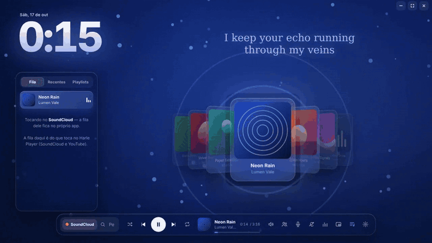
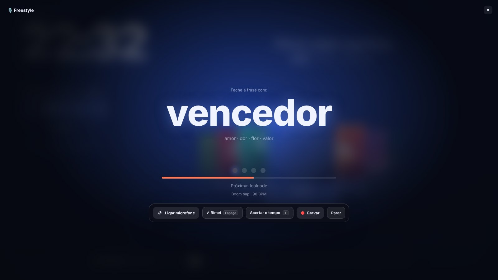
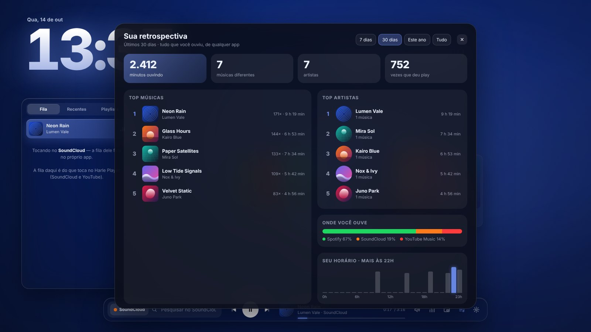

<div align="center">


# Harle Player

**An aesthetic desktop music player.**
Works with Spotify, YouTube Music, SoundCloud, Apple Music, Deezer and anything else playing on your PC.


[](https://github.com/Harlezinhuu/HarlePlayer/actions/workflows/build.yml)
[](https://github.com/Harlezinhuu/HarlePlayer/actions/workflows/search-check.yml)



🇧🇷 [Leia em português](README.md)

</div>

> The app's interface is in Brazilian Portuguese. The Freestyle game has English rhymes too.

## ✨ What it does

### 🎧 Listening
- **Works with any music app.** It reads what's playing through the Windows media system, with no login and no API key. Spotify keeps playing in Spotify (so it still counts toward your Wrapped), and Harle Player just shows and controls it.
- **Plays SoundCloud and YouTube Music inside the app**, no browser needed. SoundCloud audio is downloaded and played here. YouTube plays through the official player, hidden, and when a video is blocked the audio comes through [yt-dlp](https://github.com/yt-dlp/yt-dlp), downloaded and kept up to date automatically.
- **Spotify-style queue**: *Play next* and *Add to queue* from the **⋯** menu or right-click, drag to reorder, shuffle, repeat (queue or one song) and clear.
- **Playlists**: create, rename, reorder and play in order or shuffled, with songs from SoundCloud and YouTube Music.
- **Your SoundCloud likes and playlists**: paste your profile link once (the person icon in the Playlists tab) and the songs you liked and your playlists show up in the app, updating by themselves. No password: on SoundCloud that's public.
- **Import a playlist by link** (or by pasting the link into search): **Spotify**, **SoundCloud** and **YouTube / YouTube Music**, no login. Spotify playlists open in the Spotify app with one click, so they **count toward Wrapped**. SoundCloud and YouTube ones play right here.
- **10-band equalizer** on the built-in player, with presets (Bass+, Vocal, Rock, Electronic…) or your own.
- **Volume**: of the built-in player, or only of the app that's playing (Spotify, for example) through the Windows mixer, without touching the whole PC's volume.
- **Shuffle and repeat** on the bar, like Spotify: on the built-in player and on the source app too, when it allows it (Windows reports whether the app supports it).
- Media keys, play/pause, next, previous and a clickable progress bar.


- **Karaoke with your voice**: removes the vocals (on the built-in player), shows big lyrics and turns on **your microphone in your headphones**, with echo and stage reverb. You can **record** and save the performance.
- **DJ voice**: between songs, a voice (in Portuguese) announces what's next, radio style, using your listening recap ("this is the 5th time you've played this one this week").

- **Listen together**: create a room, share the code, and whatever you play plays in your friends' app at the same second (pause, skip and seek together). Everyone listens on their own PC, through Harle Player or by opening it in their own Spotify. There are emoji reactions on everyone's screen and song requests. Messages go through [ntfy.sh](https://ntfy.sh), **encrypted** (AES-GCM) with a key that only exists in the invite code.

### 🎙️ Freestyle
- **A rhyme game on the beat**: the beat plays and, every bar, a word shows up for you to end your line rhyming with it. The next word is already shown below, and dots mark the beat.
- **Practice**: a word every 2 bars, with rhyme hints. **Challenge**: 1 minute, a changing topic, a word every bar and harder and harder rhymes. At the end, it shows how many you nailed.
- **Portuguese or English**: separate rhyme banks grouped by sound family, with easy and hard rhymes.
- **Built-in beat** (boom bap, trap or lo-fi, at any BPM, synthesized live) or **the instrumental of any song**: the app searches YouTube Music and SoundCloud, then finds the BPM and where the bar's "1" falls by listening to the audio. If there's no instrumental, it removes the vocals.
- Microphone in your headphones and **recording** of your freestyle, just like karaoke.



### 🔎 Search
- **Searches SoundCloud and YouTube Music directly**, including tracks that only exist on SoundCloud (remixes, unreleased…).
- **All · Songs · Artists tabs**: top results and the full list, which loads more as you scroll. Click a song and it plays, with the rest of the list becoming the queue.
- For other services, or if the site's search fails, results come from Deezer.

### 📊 Your recap
- **Your own "Wrapped"**, from any app (Spotify, SoundCloud, YouTube…): minutes listened, top songs and artists, where you listen most and your favorite time of day, over 7 days, 30 days, the year or all time.
- **Creates a stories image** (1080×1920) to save or copy and post. Everything is stored only on your PC.
- **Video recap**: 22 animated seconds in stories format, with numbers counting up, your #1 artist and top 5, playing a clip of your most played song.



### 🎨 Look and feel
- **Themes**: classic or mirrored layout, accent color from the cover or fixed (any color), lyrics font and size, and a darker background.
- **Giant clock** in three styles: Solid, Thin and Outline.
- **Synced lyrics** via [LRCLIB](https://lrclib.net): the whole line with words lighting up karaoke style, or in big animated chunks.
- **Music video background**: the official video of the song that's playing (even on Spotify) shows in the background, muted and synced.
- **Particles and drops**: particles dance to the bass and, when the song "drops", the screen flashes, shakes and the cover explodes into pieces.
- **Reacts to sound**: the background, the clock's glow and the cover pulse with the bass of whatever is playing, from any app. On the wallpaper it's optional, for those who prefer a still desktop.
- **Mini player**: a small always-on-top window in the corner with cover and controls. It opens by itself when you minimize the app while music is playing and hides when you come back. Drag it anywhere.
- **Fullscreen** (`F11`): the controls fade away, leaving just the clock, cover and lyrics, like a screensaver.
- **3D cover carousel** with what you played recently. Spin it with the mouse wheel or the ← → keys.
- **Dynamic background** made from the cover. The app's accent color follows the cover too.
- **Animated wallpaper behind your desktop icons**, Wallpaper Engine style, with the clock, lyrics and song right on the desktop.
- **Wallpaper library**: video (mp4/webm), GIF or image, plus **Aurora**, a built-in animated background that changes color with the cover.

### 🔌 Integrations
- **Global hotkeys** that work even in games: `Ctrl+Alt+Space` (play/pause), `Ctrl+Alt+→/←` (next/previous), `Ctrl+Alt+↑/↓` (volume) and `Ctrl+Alt+M` (mini player).
- **Lowers the music when someone talks on Discord**: the app reads Discord's level in the Windows mixer and lowers the music (even Spotify's) while people talk on the call, bringing it back when they stop.
- **Floating lyrics** (`Ctrl+Alt+L`): lyrics show as subtitles at the bottom of the screen, on top of everything, without blocking clicks.
- **New song toast**: a card shows in the corner when the song changes (and on volume changes via hotkey), without stealing focus from your game.
- **Discord Rich Presence**: "Listening to SoundCloud" (or YouTube Music, YouTube…) on your profile, with cover, artist, time bar and a "Listen on …" button. It detects where music is playing by itself, even in the browser.
- **Phone remote**: turn it on in settings, point your camera at the QR code and your phone becomes a remote (play, skip, volume, scrolling lyrics, queue and search), with nothing to install. Works on Android and iPhone on the same Wi-Fi. Access is protected by a token only the QR code has.
- **Updates itself**: tells you when a new version is out on Releases, then downloads, installs and relaunches with one click.
- Lives in the **system tray** when you close it.


## ⌨️ Shortcuts

| Key | Action |
|---|---|
| `Space` | Play / pause |
| `/` or `Ctrl+K` | Search |
| `←` `→` | Spin the carousel |
| `Ctrl+Alt+Space` / `→` / `←` / `↑` / `↓` / `M` / `L` | Global hotkeys: play/pause, next, previous, volume, mini player, floating lyrics |
| `F11` (or double-click the top) | Fullscreen: after 3 s idle, only the clock, cover and lyrics remain |
| `Esc` | Close search / settings / exit fullscreen |
| `Space` / `T` (in Freestyle) | Mark that you rhymed / sync the beat (4 taps reset the BPM) |
| Right-click a song | Play next, add to queue or to a playlist |
| Mouse wheel on 🔊 | Adjust volume |

## 📥 Download

Go to [**Releases**](https://github.com/Harlezinhuu/HarlePlayer/releases) and download `Harle.Player_x.x.x_x64-setup.exe`. Once installed, new versions arrive through the app itself.

> **"Windows protected your PC"?** That SmartScreen warning shows up for any app without a code-signing certificate (paid and expensive for a personal project). Click **More info → Run anyway**. The installer is built by GitHub Actions straight from this code, and you can check each version's build in the [Actions](https://github.com/Harlezinhuu/HarlePlayer/actions) tab.

## 🎮 Setting up Discord

Discord shows the **app name** on your profile. So you can have one app per service, and your profile reads "Listening to **SoundCloud**", "Listening to **YouTube Music**" and so on.

1. Go to [discord.com/developers/applications](https://discord.com/developers/applications) → **New Application** → give it the name that should appear (e.g. `SoundCloud`).
2. Copy the **Application ID** and paste it under the right service in [`src-tauri/discord-apps.json`](src-tauri/discord-apps.json). If you want one app for everything, use `default`.
3. (Optional) Under **Rich Presence → Art Assets**, upload:
   - `logo`: image used when the song has no cover;
   - an icon named after the service (`soundcloud`, `ytmusic`, `youtube`…), shown small in the corner of the cover.
4. Build again. The IDs are embedded in the app, so anyone who downloads the Release gets everything ready.

The cover comes from Deezer (Discord only accepts images by URL). If the song isn't there, `logo` is shown.

**How it knows where music is playing:** desktop apps (Spotify, YouTube Music Desktop, Apple Music…) identify themselves. In the browser, it looks for the site's name in the titles of open windows. If it can't find it, it uses the *"Music playing in the browser counts as"* setting.

## 🛠️ Running the code

Requirements: [Node.js](https://nodejs.org), [Rust](https://rustup.rs) and [WebView2](https://developer.microsoft.com/microsoft-edge/webview2/) (already included in Windows 10/11).

```bash
npm install
npm run dev      # opens the app in development mode
npm run build    # builds the installer in src-tauri/target/release/bundle/nsis
```

To work only on the UI, without compiling anything, use `npm run demo`.

### Tests

```bash
npm test                                              # front end: queue, lyrics, titles, colors, BPM…
cargo test --manifest-path src-tauri/Cargo.toml       # Rust: Discord, detection, search parsing
cargo test --manifest-path src-tauri/Cargo.toml ao_vivo -- --ignored --nocapture   # real searches
```

GitHub Actions runs everything on every push and builds the installer. The live search check also runs daily, to catch changes on SoundCloud or YouTube Music.

`npm run demo` opens the front end in the browser with sample songs, lyrics and search.

## 🧩 How it works

```
┌──────────── Front (src/) ────────────┐        ┌──────────────── Rust (src-tauri/src/) ────────────────┐
│ Plain HTML + CSS + JS, no build      │        │ media.rs     Windows SMTC: now playing + controls     │
│ app.js     core (playback, lyrics)   │        │ detect.rs    which service (app or browser tab)       │
│ features/  one file per feature:     │◀──IPC─▶│ search.rs    SoundCloud · YouTube Music · videos      │
│   library.js  queue and playlists    │        │ net.rs       LRCLIB (lyrics) and Deezer               │
│   search.js   full search            │        │ party.rs     listen-together rooms (ntfy.sh)          │
│   settings.js settings panel         │        │ ytdlp.rs     YouTube fallback                         │
│   wrapped.js  listening recap        │        │ volume.rs    per-app volume (WASAPI)                  │
│   karaoke · freestyle · party.js     │        │ visualizer.rs PC audio bass level (WASAPI)            │
│   remote.js   phone remote           │        │ ducking.rs   Discord voice → lower the music          │
│   desktop.js  toasts, hotkeys, DJ    │        │ discord.rs   Rich Presence (named pipe)               │
│ player.js  built-in player + YouTube │        │ wallpaper.rs window in the WorkerW layer              │
│ queue.js · stats.js · lib.js (pure)  │        │ mini.rs      always-on-top mini window                │
│ party.js   rooms with AES-GCM        │        │ overlay.rs   floating lyrics above everything         │
│ drops.js · fx.js   drops, particles  │        │ notify.rs    corner toast without stealing focus      │
│ rhymes.js · bpm.js · freestyle.js    │        │ hotkeys.rs   global hotkeys (RegisterHotKey)          │
│ karaoke.js · wrappedVideo.js · qr.js │        │ remote.rs    local network HTTP server (phone)        │
│ mini.js · remote.html (phone)        │        │ updater.rs   GitHub Releases → install and relaunch   │
└──────────────────────────────────────┘        └───────────────────────────────────────────────────────┘
```

Wallpaper mode uses the same trick as Wallpaper Engine and Lively: Explorer creates a layer called **WorkerW** between the wallpaper and the icons, and the app hangs a second window on it.

SoundCloud search uses `api-v2` with the public `client_id` the site itself loads. YouTube Music search uses the internal `youtubei/v1/search` API, the same one used by [ytmusicapi](https://github.com/sigma67/ytmusicapi). Neither is official: if a site changes, the app shows a warning and falls back to Deezer.

The song position is measured by the source app and interpolated in the front end every frame. In karaoke mode, each lyric line's time (LRC) is split across its words by their length.

The queue remembers which songs you added: they go right after the current one, before the rest (search results or playlist), just like Spotify. Songs saved by name only (from Deezer, for example) are looked up on SoundCloud/YouTube when it's time to play them.

Freestyle finds the rhythm by listening to the audio itself: it measures onsets (rises in energy), finds the period by autocorrelation while checking that the pattern repeats every beat, every 2 beats and every bar (which avoids mistaking 90 for 120 or 67 BPM because of kick syncopation), refines BPM and phase together with a beat comb, and picks the beat with the strongest onset as the "1". The built-in beat is synthesized live with Web Audio (kick, snare, hi-hat, bass and chords), with no sound files at all.

In the front end, `app.js` holds the core (now playing, player, background and lyrics) and each larger feature lives in `features/`, receiving an `app` object with what it needs. That object's getters always return the current value, so the now-playing song, for example, is never stale inside a feature.

## 🗺️ Roadmap

- [ ] Start with Windows
- [ ] Wallpaper on multiple monitors
- [ ] macOS support

## 📄 License

**All rights reserved.** The code is public for viewing and learning only: copying, modifying or reusing it without permission is not allowed. Using the app from [Releases](../../releases) is free. Details in [LICENSE](LICENSE).

Made by **Harle**.
