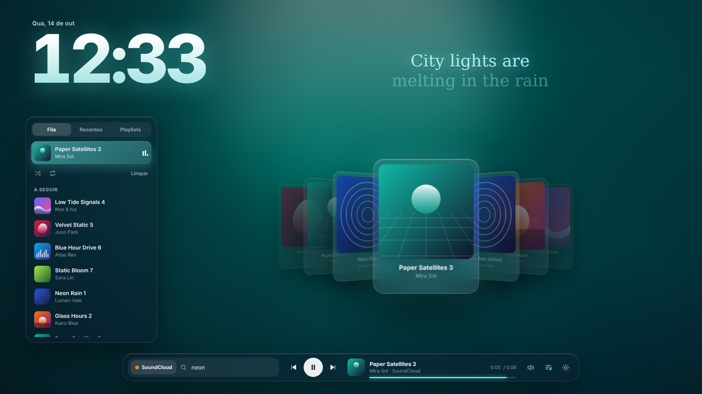
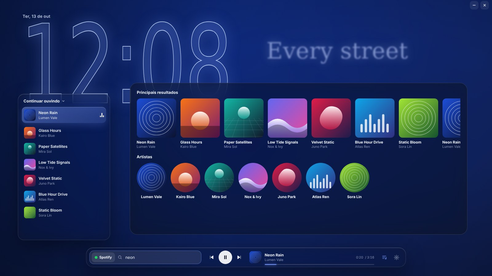
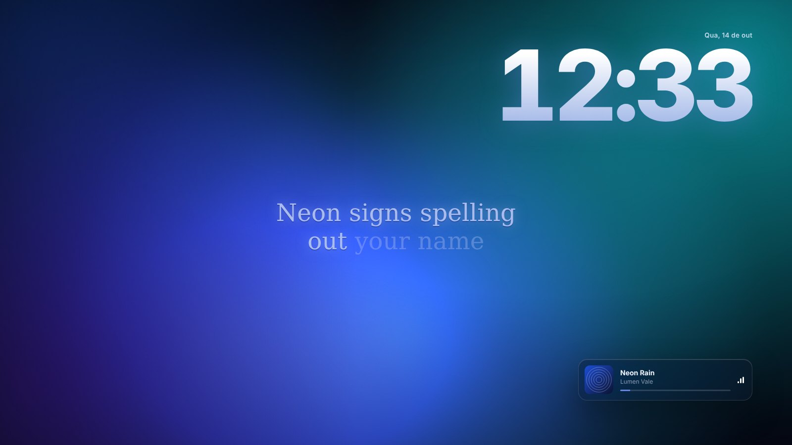

<div align="center">


# Harle Player

**Um player de música estético pro desktop.**
Funciona com Spotify, YouTube Music, SoundCloud, Apple Music, Deezer e o que mais estiver tocando no seu PC.


[](https://github.com/Harlezinhuu/HarlePlayer/actions/workflows/build.yml)
[](https://github.com/Harlezinhuu/HarlePlayer/actions/workflows/search-check.yml)



</div>

## ✨ O que ele faz

- **Funciona com qualquer app de música.** Lê o que está tocando pelo sistema de mídia do Windows (o mesmo do controle de volume), sem login e sem chave de API.
- **Carrossel 3D de capas** com o que você ouviu por último. Dá pra girar com a roda do mouse ou com as setas ← →.
- **Letra sincronizada** aparecendo em pedacinhos animados em cima do fundo, via [LRCLIB](https://lrclib.net).
- **Relógio gigante** em fonte condensada, no estilo de tela de bloqueio.
- **Fundo dinâmico** feito com a capa da música. A cor de destaque do app também muda conforme a capa.
- **Busca direto no SoundCloud e no YouTube Music**, inclusive faixas que só existem no SoundCloud (remix, unreleased…). O clique abre direto na música. Pros outros serviços, ou se a busca do site falhar, os resultados vêm do Deezer.
- **Controles**: tocar/pausar, próxima, anterior e barra de progresso clicável.
- **Wallpaper animado atrás dos ícones**, no estilo Wallpaper Engine. Mostra o relógio, a letra e a música tocando direto na área de trabalho.
- **Biblioteca de wallpapers**: vídeo (mp4/webm), GIF ou imagem, mais o **Aurora**, um fundo animado embutido que muda de cor conforme a capa.
- **Discord Rich Presence**: mostra "Ouvindo SoundCloud" (ou YouTube Music, YouTube…) no seu perfil, com capa, artista, barra de tempo e botão "Ouvir no …". Detecta sozinho onde a música está tocando, até no navegador.
- **Pausa sozinho com jogo em tela cheia**, pra não roubar FPS. Também pode pausar com janela maximizada.
- Fica na **bandeja do sistema** quando você fecha.





## ⌨️ Atalhos

| Tecla | Ação |
|---|---|
| `Espaço` | Tocar / pausar |
| `/` ou `Ctrl+K` | Pesquisar |
| `←` `→` | Girar o carrossel |
| `Esc` | Fechar busca / configurações |

## 📥 Baixar

Vá em [**Releases**](https://github.com/Harlezinhuu/HarlePlayer/releases) e baixe o `Harle Player_x.x.x_x64-setup.exe`.

## 🎮 Configurando o Discord

O Discord mostra o **nome do app** no perfil. Por isso dá pra ter um app pra cada serviço, e o perfil fica "Ouvindo **SoundCloud**", "Ouvindo **YouTube Music**" e assim por diante.

1. Entre em [discord.com/developers/applications](https://discord.com/developers/applications) → **New Application** → dê o nome que deve aparecer (ex.: `SoundCloud`).
2. Copie o **Application ID** e cole no serviço certo em [`src-tauri/discord-apps.json`](src-tauri/discord-apps.json). Se quiser um app só pra tudo, use o `default`.
3. (Opcional) Em **Rich Presence → Art Assets**, suba:
   - `logo`: imagem usada quando a música não tem capa;
   - um ícone com o nome do serviço (`soundcloud`, `ytmusic`, `youtube`…), que aparece pequeno no canto da capa.
4. Compile de novo. Os IDs vão embutidos no app, então quem baixar a Release já recebe tudo pronto.

A capa vem do Deezer (o Discord só aceita imagem por link). Se a música não existir lá, aparece o `logo`.

**Como ele sabe onde está tocando:** apps de desktop (Spotify, YouTube Music Desktop, Apple Music…) se identificam sozinhos. No navegador, ele procura o nome do site nos títulos das janelas abertas. Se não achar, usa a opção *"Música tocando no navegador conta como"* das configurações.

## 🛠️ Rodando o código

Pré-requisitos: [Node.js](https://nodejs.org), [Rust](https://rustup.rs) e o [WebView2](https://developer.microsoft.com/microsoft-edge/webview2/) (já vem no Windows 10/11).

```bash
npm install
npm run dev      # abre o app em modo desenvolvimento
npm run build    # gera o instalador em src-tauri/target/release/bundle/nsis
```

Pra mexer só no visual, sem compilar nada, use `npm run demo`.

### Testes

```bash
npm test                                              # front: letra, títulos, cores…
cargo test --manifest-path src-tauri/Cargo.toml       # Rust: Discord, detecção, leitura das buscas
cargo test --manifest-path src-tauri/Cargo.toml ao_vivo -- --ignored --nocapture   # busca de verdade
```

O GitHub Actions roda tudo a cada push. A busca ao vivo também roda todo dia, pra avisar se o SoundCloud ou o YouTube Music mudarem alguma coisa. Ele abre o front no navegador com músicas e letra de exemplo.

## 🧩 Como funciona

```
┌────────────── Front (src/) ──────────────┐      ┌────────────── Rust (src-tauri/) ───────────────┐
│ HTML + CSS + JS puro                     │      │ media.rs → GlobalSystemMediaTransportControls │
│ relógio · carrossel 3D · letra · busca   │◀────▶│   lê título/artista/capa/posição a cada 400ms │
│                                          │ IPC  │   e manda play/pause/próxima pro app de música│
│ duas janelas: player e wallpaper         │      │ net.rs   → LRCLIB (letras) e Deezer (busca)   │
└──────────────────────────────────────────┘      │ wallpaper.rs → janela atrás dos ícones        │
                                                  │   (WorkerW) + detecta jogo em tela cheia      │
                                                  │ main.rs  → bandeja e comandos                 │
                                                  └───────────────────────────────────────────────┘
```

O modo wallpaper usa o mesmo truque do Wallpaper Engine e do Lively: o Explorer cria uma camada chamada **WorkerW** entre o papel de parede e os ícones, e o app pendura uma segunda janela nela. A cada 1,2 s o Rust confere se o app em foco está em tela cheia, e o wallpaper congela enquanto estiver.

A busca do SoundCloud usa a `api-v2` com o `client_id` público que o próprio site carrega. A do YouTube Music usa a API interna `youtubei/v1/search`, a mesma usada pela [ytmusicapi](https://github.com/sigma67/ytmusicapi). Nenhuma das duas é oficial: se o site mudar, o app mostra um aviso e cai pro Deezer.

A posição da música é medida pelo app de origem e interpolada no front a cada frame. Cada verso da letra (LRC) é quebrado em pedaços de 1–3 palavras, e o tempo do verso é distribuído entre eles pelo tamanho de cada pedaço.

## 🗺️ Próximos passos

- [ ] Suporte a macOS
- [ ] Tocar direto pelo app (Spotify Web API / MusicKit)
- [ ] Iniciar junto com o Windows
- [ ] Wallpaper em vários monitores
- [ ] Wallpapers que reagem ao som (visualizador)
- [ ] Temas e posição dos elementos personalizáveis

## 📄 Licença

MIT. Criado por **Harle**.
